# Primer 界面迁移完成报告

日期：2026-10-11。分支 `claude/init-092a7a`。
设计：[`docs/architecture/2026-10-10-primer-gui-redesign-design.md`](../architecture/2026-10-10-primer-gui-redesign-design.md)。
计划（已完成并删除）：`docs/codex_docs/2026-10-10-primer-gui-redesign-plan.md`。

## 结果概述

`athena-gui/` 已从自建设计系统整体迁移到 GitHub Primer：`@primer/react` 38.40.1、
`@primer/primitives` 11.10.0、Octicons、Mona Sans 字体；亮色为 Primer Light，暗色为 Primer Dark。
自写的 token 与通用组件类（`.btn`、`.input`、`.badge`、`.card` 等）、兼容层、`lucide-react` 与
Geist 字体依赖已全部删除。只改动前端，未触及 Python、Rust 与网关协议。

提交（`git log c029b0e~1..HEAD`，由旧到新）：

| 提交 | 内容 |
|---|---|
| c029b0e | 新增 Primer 迁移设计与实施计划 |
| d17214c | 接入 Primer 主题、字体与 Octicons 图标 |
| b77f4d2 | 新增基于 Primer 的共享面板部件与状态映射 |
| 4931632 | 外壳改为 GitHub 仓库页式顶栏与模块标签栏 |
| 32023fd | 工作区选择页改用 Primer 组件 |
| f32cf04 | 会话区改用 Primer 组件 |
| 2d12baa | 设置面板改为 Primer Dialog 与表单控件 |
| d477f9e | 人工确认弹窗改为 Primer Dialog 与选项列表 |
| fcfc04b | 实验类面板改用 Primer 组件 |
| 4498282 | 轨迹、报告、图算法与 EDA 面板改用 Primer 组件 |
| 8b7a733 | 指标图、研究树与假设图改用 Primer 配色与卡片 |
| 78e34f7 | 删除旧设计系统、兼容层与 lucide/Geist 依赖 |
| daa42ac | 修复实机验收发现的弹窗、配色方案与可访问性问题 |

每个任务均经独立评审，评审结论为 clean；各任务的评审台账与报告为本地记录，未入库。

## 与 spec 的差异清单

| 位置 | spec 要求 | 实际 | 原因 / 影响 |
|---|---|---|---|
| §5.4 侧栏 | 详情栏、日志栏「不遮挡主区」 | 两个抽屉仍为 `position:absolute` 覆盖层，主区不预留宽度，同时打开会互相覆盖 | 覆盖层在迁移前已存在；spec 同节同时写明「保持非模态侧栏」，按非模态理解。若要三栏预留宽度需另做布局改动 |
| §5 模块计数 | 研究树、实验均显示计数 | 只接通实验计数，来源 `searchAttempts`，无研究树计数 | 视图模型没有树/实验总数，补齐需要新增 RPC；计划即如此限定。`searchAttempts` 与实验列表总数口径不同，可能不含 baseline |
| 会话列表 | `NavList` | `ActionList` + `TrailingAction` | 每行需要尾部操作按钮，`NavList` 不支持。Codex 指出 `active` 只产生视觉标记，已在 daa42ac 恢复 `aria-current="page"` |
| §7 Markdown 表格 | 表格排版 | 表格样式已写入但无效 | `react-markdown` 未接入 `remark-gfm`，管道表格不被解析为 `<table>`；迁移前即如此，见遗留项 |
| §9 键盘 | 全部入口可用键盘到达 | 实验管理表格的行仍只绑定 `<tr onClick>` | 迁移前即如此（Task 8 台账：plan-mandated），见遗留项 |
| 人工确认弹窗 Esc | Esc 仅在允许跳过时生效 | 改用文档级捕获阶段 `keydown` 监听，并让 Dialog `onClose` 为空操作 | Primer 38.40.1 把遮罩点击也报告为 `onClose("escape")`，直接转 skip 会误提交（Codex C1）；`useOnEscapePress` 因 Primer 自身 Esc 处理会 `preventDefault` 并截断而无法使用 |
| 设置弹窗初始焦点 | 未指定 | 初始焦点落在「项目目录」输入框（`initialFocusRef`） | 默认落在关闭按钮，其 tooltip 吞掉第一次 Esc，需按两次 |
| 暗/亮配色方案 | 随主题切换 | 在 `[data-color-mode]` 上显式声明 `color-scheme` | 否则暗色下原生滚动条与 select 弹层为浅色 |
| §6.1 `.switch` | `ToggleSwitch` | 设置弹窗与研究树自动保存用 `Checkbox` + `FormControl` | GitHub 设置页的布尔项即如此，保留复选框语义并使既有测试不变（计划 Task 6） |
| §6.3 工作区选择页「最近使用」 | `ActionList` | `Button variant="invisible"` 列表 | `App.test.tsx` 依赖按 `title` 点击最近路径，真按钮语义更直接（计划 Task 4） |
| §6.3 文件面板目录 | `TreeView` | 未使用，展示键值与产物列表 | 后端不返回目录层级（计划 Task 8） |
| §6.1 `title=` | Primer `Tooltip` | 未使用 `Tooltip`；RunControls、日志栏「清空」、ThemeToggle 的 title 已去掉，IconButton 的提示来自 `aria-label`；截断文本仍用原生 `title` | 简化；暂停/继续/停止等按钮的 title 提示因此丢失 |
| 图标 | 一对一 Octicons | 部分旧图标名映射到同一 Octicon（wrench/hammer、loader/refresh、algorithms/sigma、network/workflow、chart/microscope） | Octicons 无完全对应项，纯外观影响 |

## 测试数与体积对比

测试（`npm --prefix athena-gui test`）：**27 个测试文件、242 项全部通过**。迁移前基线为 191 项
（外加一个被 Vitest 误收集的 node:test 文件，Task 1 已修复）；各任务后依次为
196→204→207→208→213→215→218→224→231→237→237，daa42ac 后为 240，终审修复（LLMIO `aria-current`、人工确认弹窗忽略 IME 组合态 Esc）后为 242。

构建（`npm --prefix athena-gui run build`，成功，仅有既有的 chunk 超 500 kB 警告）：

| 指标 | 迁移前 | Task 11 后 | 当前（新测） |
|---|---|---|---|
| JS 合计 | 1009.5 kB | 1643.2 kB | 1643.5 kB |
| CSS 合计 | 112.5 kB | 420.7 kB | 420.8 kB |
| `dist` 合计 | 1409.7 kB | 2128.3 kB | 2128.7 kB |
| 主 chunk（原始 / gzip） | — | 883.9 kB / 220.0 kB | 884.2 kB / 220.1 kB |

当前值比 Task 11 略大（JS +0.3 kB、主 chunk +0.3 kB），来自 daa42ac 的修复；其余无异常。
体积增长约 63%（JS）、274%（CSS）来自 Primer 运行时与全量样式，属预期，未做拆包优化。

## 实机验收结论

由控制者在内置浏览器面板完成（逐项记录为本地文件，未入库）：Python 网关 + Vite 开发服务器
（:1421）+ 生产构建预览（:1422），视口 1440×900 / 900×700 / 600×700，亮/暗两套。

- **逐屏**：工作区选择、会话、研究树、假设图、指标图、实验管理与详情、实验日志、数据分析/模型轨迹/报告空状态、
  日志侧栏，亮暗均无白底残留、文字不可读或溢出；ReactFlow 边、节点状态色条、SOTA 琥珀色、迷你地图随主题正确；
  设置弹窗页脚不再压住表单；Mona Sans Variable 已加载。
- **键盘**：顶栏→模块标签→侧栏→主区的 Tab 顺序完整，焦点环均可见；两个弹窗焦点受限；
  人工确认弹窗 `allow_skip=false` 时 Esc 无效，为 true 时触发 skip，失败时显示 danger Flash。
- **窄窗口**：900px 与 600px 下 6 个模块标签放得下，无横向滚动；面包屑工作区名带完整路径 `title`。
- **发现并修复**：`color-scheme` 缺失、设置弹窗需按两次 Esc（均在 daa42ac 修复）；LLMIO 消息块被压缩（Codex C2）按 CSS
  分析修复并实机确认（14 个气泡 `flex-shrink:0`，无裁切，面板可滚动）。
- **开发态假象，不修**：开发态（StrictMode）下弹窗关闭后焦点落在 body，生产构建中设置弹窗关闭后焦点回到「设置」按钮，
  原因是焦点陷阱在 StrictMode 下双挂载。

**未覆盖**：

- 有数据的研究树、假设图、指标图、实验列表/日志/详情使用开发态临时桩（在页面内替换 `wsBackend.call` 返回 6 个假实验，
  不入库）；人工确认弹窗通过 `wsBackend.handleMessage` 注入假 `human_request` 事件。因此这些视图未用真实后端数据验证。
- 模型轨迹消息流、报告统计、EDA 的 markdown/图片有数据形态未实机查看（无数据源）。
- 窄于约 450px 时的「More items」菜单未实测（Tauri 窗口不会这么窄）。

## 界面截图

1440×900，无头 Chrome 截取。工作区为临时空目录；研究树、实验、模型轨迹中的数据与人工确认请求均为上文所述的
开发态假数据，仅用于展示界面。

| 暗色 | 亮色 |
|---|---|
| 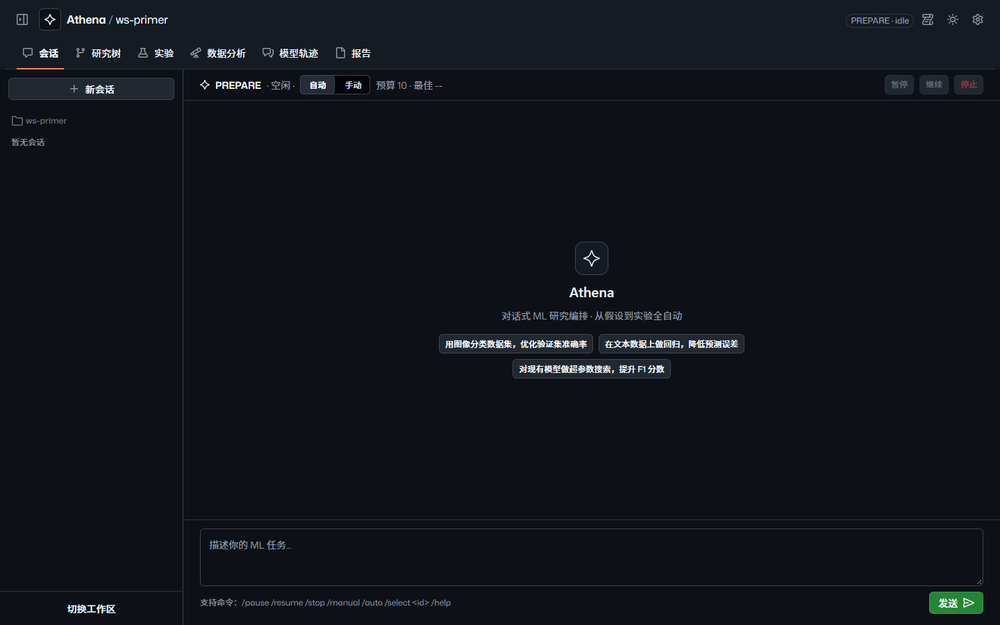 | 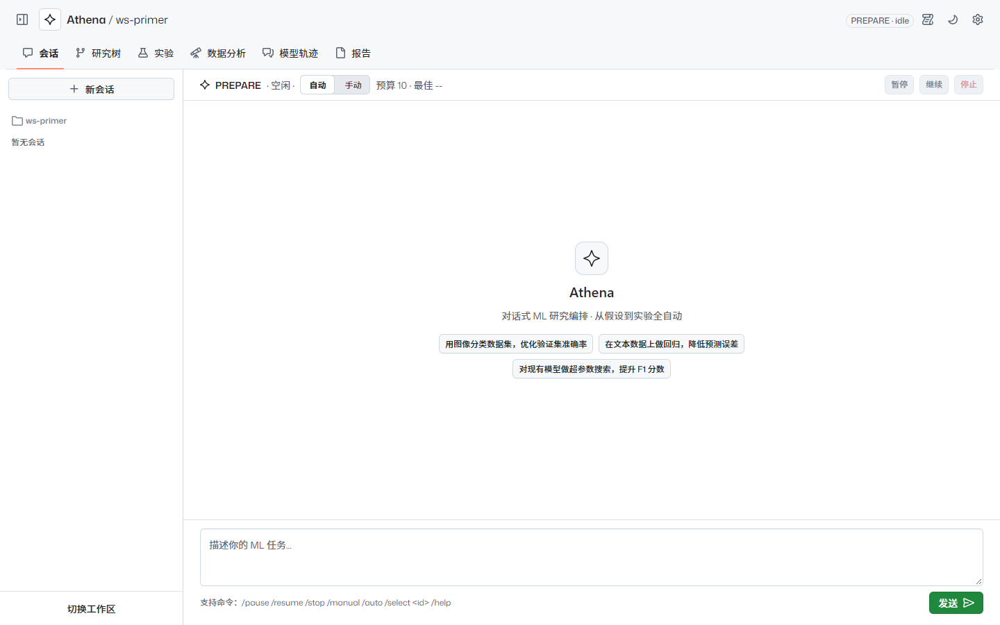 |
| 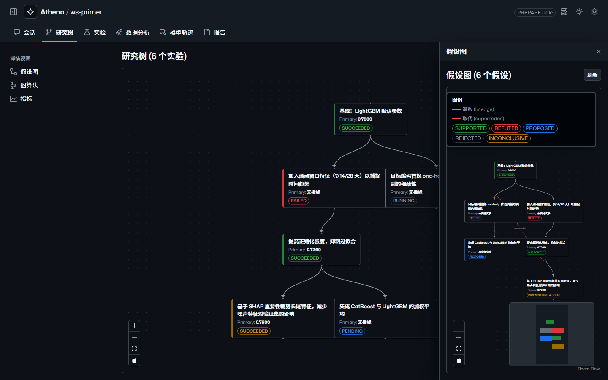 | 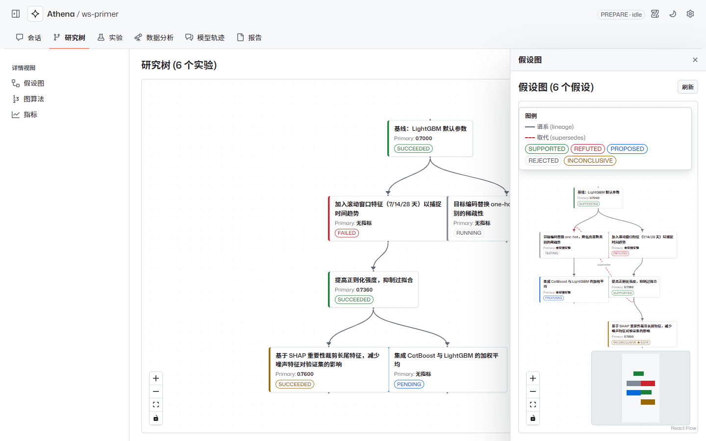 |
| 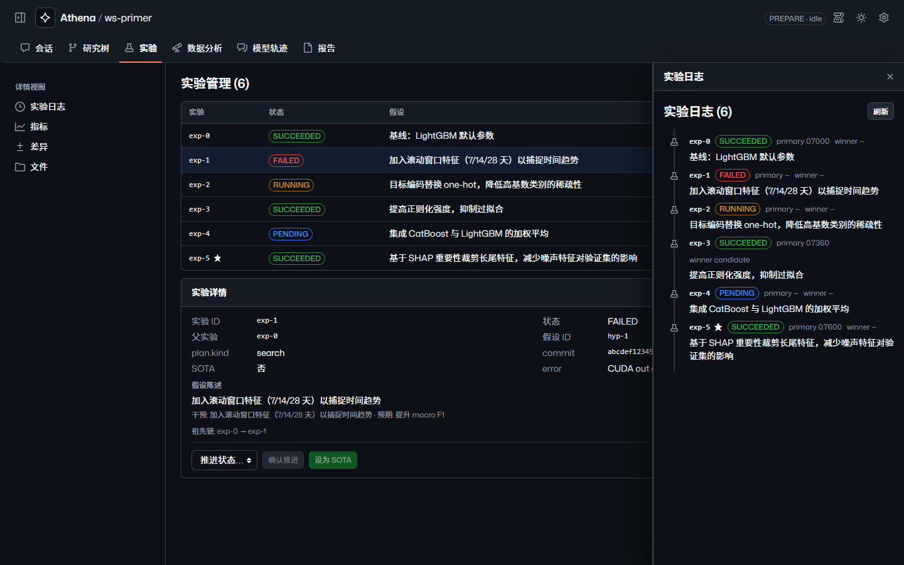 | 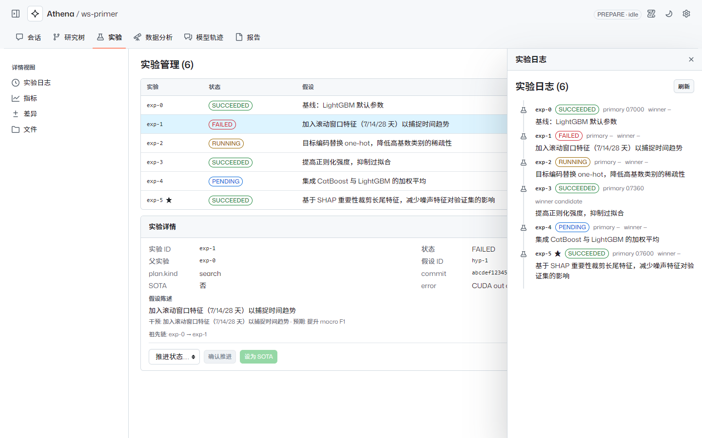 |
| 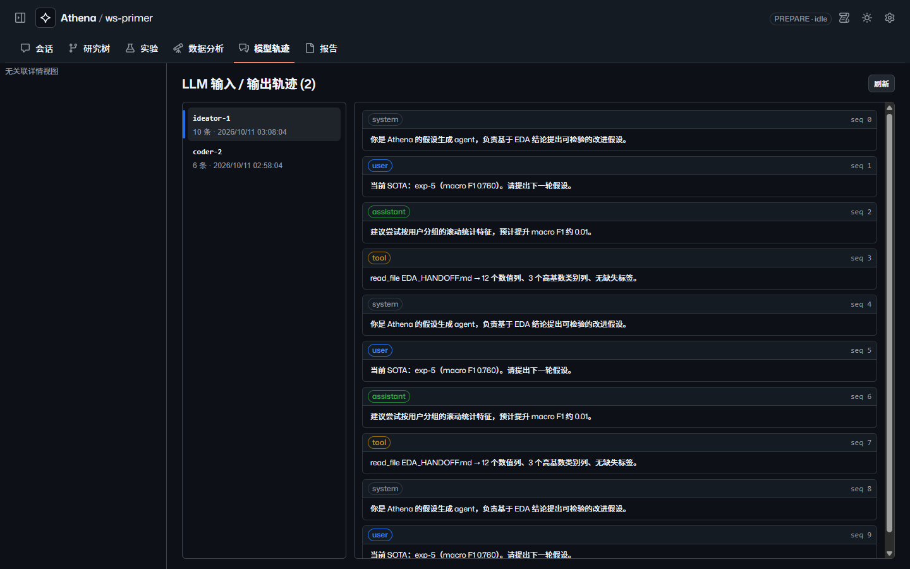 | 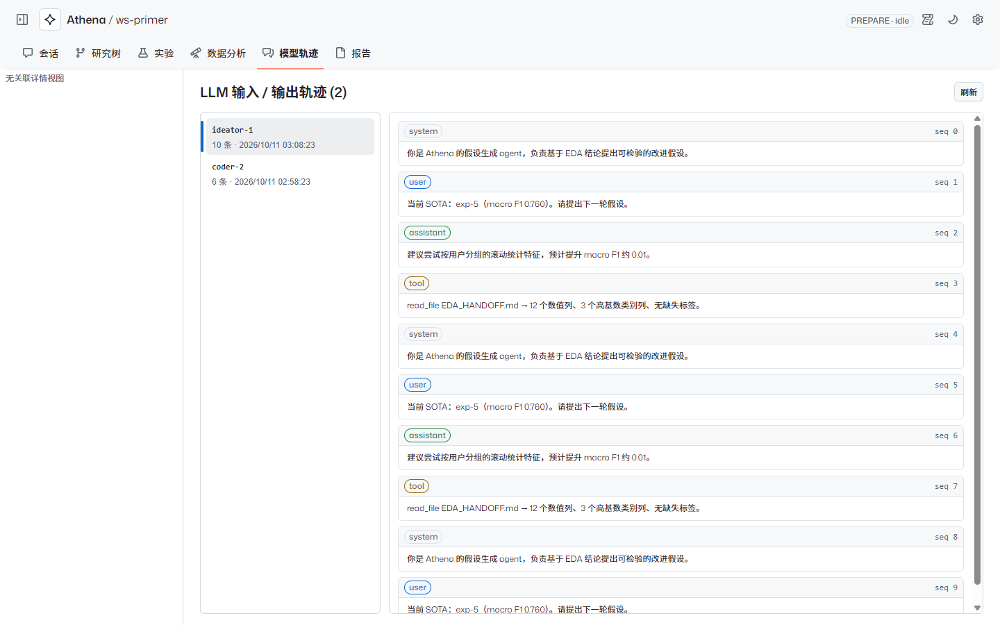 |
| 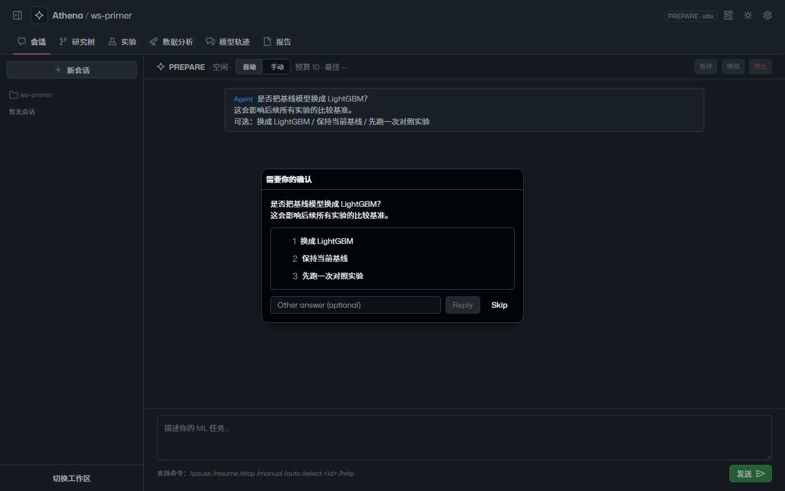 | 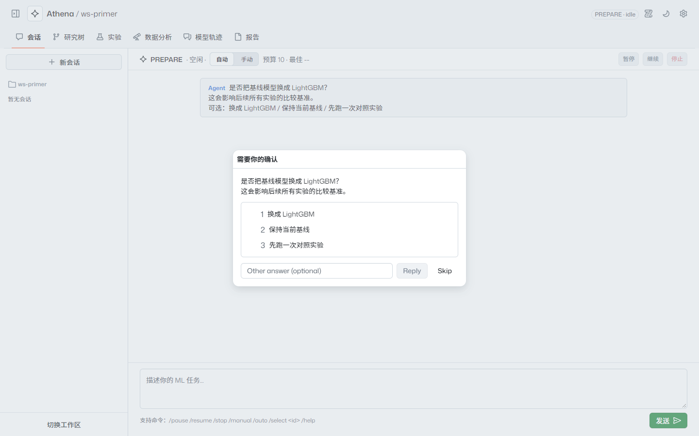 |

工作区选择页（暗）：

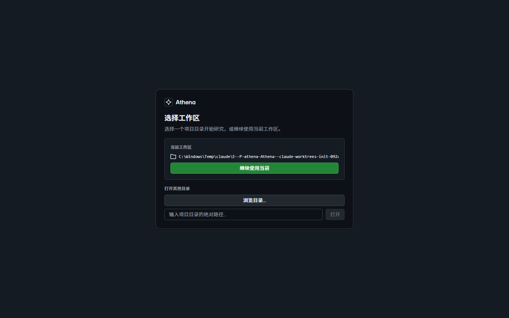

## Codex 评审处理

Codex 只读评审（`codex exec --sandbox read-only`）共 7 项，`tsc --noEmit` 与 `git diff --check` 通过。
控制者逐项裁定（台账 `Ruling:`）：

| # | 级别 | 发现 | 处理 |
|---|---|---|---|
| C1 | P1 | 点击遮罩被 Primer 报告为 `onClose("escape")`，误提交「跳过」 | 已修复（daa42ac）：Dialog `onClose` 空操作，Esc 改用捕获阶段文档监听，仅 `allow_skip` 且非提交中时生效；测试覆盖遮罩点击与 Esc |
| C2 | P2 | 长模型轨迹的消息块被 flex 压缩并裁切 | 已修复（daa42ac）：`.bubble { flex-shrink: 0 }`，实机确认 |
| C3 | P2 | 右侧栏仍遮挡主区 | 暂缓：覆盖层迁移前已存在，spec 同节写明「非模态侧栏」，按非模态理解；记为 spec 措辞差异，三栏预留宽度另立任务 |
| C4 | P2 | 会话列表丢失 `aria-current` | 已修复（daa42ac）：`ActionList.Item` 上恢复 `aria-current="page"`，测试覆盖 |
| C5 | P2 | 实验管理行只能点击，键盘无法打开详情 | 暂缓：迁移前即如此，计划即限定为保持行为；作为后续无障碍任务 |
| C6 | P2 | Markdown 表格无 GFM 解析，样式不生效 | 暂缓：迁移前即如此，引入依赖并改变解析语义超出视觉迁移范围；后续任务 |
| C7 | P3 | 模块计数仅实验、口径为 `searchAttempts` | 暂缓并记为差异：视图模型无总数，需新增 RPC |

上表 C 编号为 Codex 报告顺序。`color-scheme` 缺失与设置弹窗需按两次 Esc 两项为实机发现，
与上表遮罩误跳过（C1）、LLMIO 压缩（C2）、`aria-current`（C4）共 5 项迁移引入的真实回归，在 daa42ac 一个提交内修复，测试由 237 增至 240；终审修复提交再增 2 项。

## 遗留与后续

建议另立任务：

1. **ExperimentManager 行键盘可达**：给行加可聚焦入口（按钮或 `role="button"` + 键盘激活），详情内状态推进与 SOTA 操作才能被键盘用户使用。
2. **remark-gfm**：为 EDA/报告的 `react-markdown` 接入 GFM，使已写好的表格样式生效；需评估新依赖与解析差异。
3. **抽屉布局**：若要兑现「不遮挡主区」，把详情栏与日志栏改为预留宽度的三栏布局，并处理同时打开的情形。
4. **模块计数**：新增（或复用）返回研究树节点数与实验总数的 RPC，补齐研究树计数并统一实验计数口径。
5. **有数据形态实机核对**：用真实运行的工作区核对模型轨迹、报告、EDA 的有数据视图，替换本次的开发态桩。
6. **清理死掉的 settings 模块残留**：`SETTINGS_MODULE`、`shell/navigation.ts` 中 `MODULE_BY_KEY`/`RELATED_PANELS` 的 settings 条目、`types/ui.ts` 的 `ModuleKey`/`CONTEXT_PANELS` 中的 `"settings"`，以及过时的功能轨注释。
7. **研究树节点标签状态色不一致**：节点标签显示实验状态文本却按假设状态着色（FlowNodeCard/ResearchTreeViz），与 ExperimentManager/ExperimentLog 的 StatusBadge 配色不一致。

台账中延期的小问题（均不阻塞，按类别归并）：

- **测试覆盖缺口**：building-blocks 仅断言 5 种边框色中的 2 种；缺少 degraded 路径（无工作区/无会话标题的面包屑）、
  `RunControls` 运行中 Spinner、App 加载占位、`ReportPanel` 有数据统计网格、算法失败后结果清空、`ResearchTreeViz` 错误/空态、
  遮罩/请求切换后的焦点落点、`aria-disabled` 选项点击等断言。
- **实现细节**：`Icon` 别名合并、`useTheme` 模块级副作用、`KeyValueList` 以 label 作 key、`hypothesisStatus` 的不可达回退、
  `.flush` 覆盖依赖 CSS 引入顺序、`HumanRequestDialog` 在渲染期给 `escapeSkipRef` 赋值且 Esc 监听为文档级，叠加其他浮层时也会触发。
- **语义与文案**：`<tr aria-selected>`、详情关闭按钮嵌在标题内导致标题名为「实验详情 关闭」、返回底部为原生 `<button>`、
  暂停/继续/停止等按钮的 title 提示丢失、`ErrorBoundary` 注释仍为英文、测试名仍写 "function-rail"。
- **迁移前已有**：重复的 SOTA 刷新逻辑、`LLMIOPanel` 在 `traceGet` 失败时保留旧消息、`ReportPanel` 生成成功时未清除旧错误。
